# Rómpelo 🎉

App móvil nativa (Flutter · Android) de **juegos rompehielo para grupos** que se juega desde **un solo
dispositivo compartido**, 100 % offline y sin registro. Catálogo inicial: **Charadas alocadas**,
**Trivia relámpago** y **El impostor silencioso**.

> Proyecto de *Desarrollo de Aplicaciones Móviles Nativas* — Ingeniería de Software, UCompensar (Bogotá, 2026).

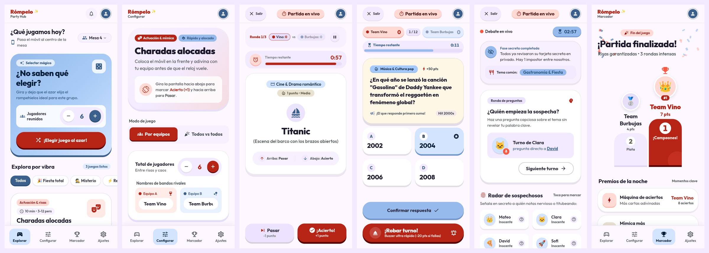

## Contenido
1. [Objetivo y requerimientos](#objetivo-y-requerimientos)
2. [Estado del proyecto](#estado-del-proyecto)
3. [Capturas](#capturas)
4. [Cómo ejecutar](#cómo-ejecutar)
5. [Stack y por qué](#stack-y-por-qué)
6. [Estructura del código](#estructura-del-código)
7. [Sistema de diseño](#sistema-de-diseño)
8. [Navegación y rutas](#navegación-y-rutas)
9. [Gestión de estado](#gestión-de-estado)
10. [Cómo agregar un juego nuevo](#cómo-agregar-un-juego-nuevo)
11. [Tests y calidad](#tests-y-calidad)
12. [Accesibilidad](#accesibilidad)
13. [Changelog por fase](#changelog-por-fase)
14. [Equipo](#equipo)

## Objetivo y requerimientos
Facilitar la interacción social cara a cara usando la menor cantidad de tecnología posible: el celular actúa
como "maestro de juego" y muestra instrucciones, palabras o preguntas mientras el grupo juega en persona.

- **Funcionales:** catálogo de juegos · configurar partida (jugadores, categorías, dificultad) · nombres de
  jugadores · Charadas con temporizador · Trivia con puntaje · Impostor con roles secretos pasando el celular ·
  marcador y ranking final · repetir o cambiar de juego sin reiniciar.
- **No funcionales:** offline · un solo dispositivo · arranque < 3 s · iniciar partida en ≤ 3 toques ·
  legible a distancia · Android · sin datos personales · código modular para agregar juegos.

| Requerimiento | Dónde se cumple |
|---|---|
| Catálogo con descripción | Home: `GameCard` por juego, filtro "Explora por vibra", "¡Elegir juego al azar!" |
| Configurar partida y nombres | `/configurar/<juego>`: jugadores, mazos, reglas, equipos y nombres (`PlayerNamesEditor`) |
| Charadas con temporizador | `TimerBar` por turno, pausa, Pasar / ¡Acierto! |
| Trivia con puntaje | Marcador por equipos o jugadores, +50 / +100, robo de turno (-20) |
| Impostor pasando el celular | Rol secreto visible **solo mientras se presiona**, radar de sospechosos y votación |
| Marcador y ranking final | `/resultados`: podio, tabla completa, premios y estadísticas |
| Repetir o cambiar de juego | "¡Jugar revancha inmediata!" (misma configuración) y "Volver al catálogo" |
| Iniciar en ≤ 3 toques | Home → "Configurar y jugar" (valores por defecto listos) → CTA de inicio; o tab Configurar → "Jugar" |
| Offline | Fuente Outfit empaquetada, contenido mock local, sin red ni registro |
| Legible a distancia | Outfit en pesos 700–900, cifras tabulares, contraste WCAG verificado en tests |
| Código modular | Feature-first + un `switch` por juego (ver [Cómo agregar un juego](#cómo-agregar-un-juego-nuevo)) |

## Estado del proyecto
✅ **Front-end completo**: todas las pantallas del mockup navegables, con los juegos como **maquetas
funcionales con datos de ejemplo** (no hay lógica real de juego, sensores ni persistencia entre sesiones).

| Fase | Contenido | Estado |
|---|---|---|
| 0 | Mockup en el repo, plan y documentación | ✅ |
| 1 | Entorno Flutter + fundaciones (tema, router, widgets core) | ✅ |
| 2 | Home / Explorar | ✅ |
| 3 | Pantallas de configuración | ✅ |
| 4 | Pantallas en partida | ✅ |
| 5 | Resultados / podio + tabs | ✅ |
| 6 | Tests, pulido y README final | ✅ |

Plan en [`docs/plan-front.md`](docs/plan-front.md), decisiones y avance en [`docs/progreso.md`](docs/progreso.md).

## Capturas
Capturas web a 390 px de ancho (`docs/screenshots/`), comparadas con el mockup de `design/stitch/`.

| Home | Configurar | Config. Charadas | Config. Trivia | Config. Impostor |
|---|---|---|---|---|
| 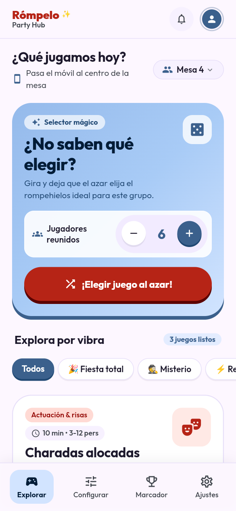 | 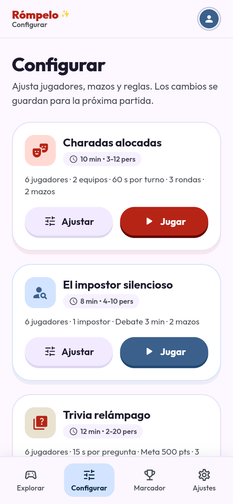 | 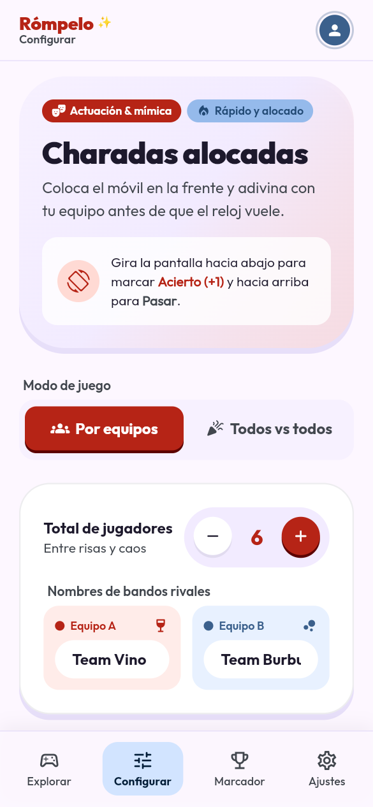 | 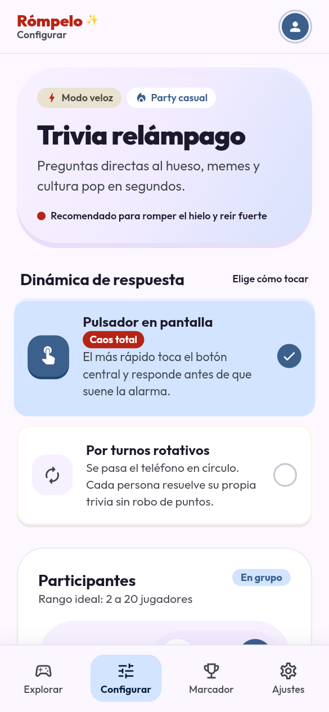 | 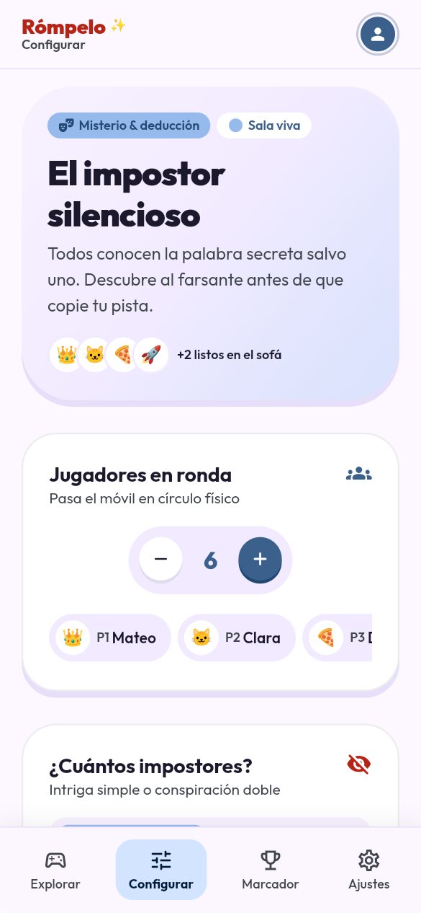 |

| Partida Charadas | Partida Trivia | Partida Impostor | Marcador | Ajustes |
|---|---|---|---|---|
| 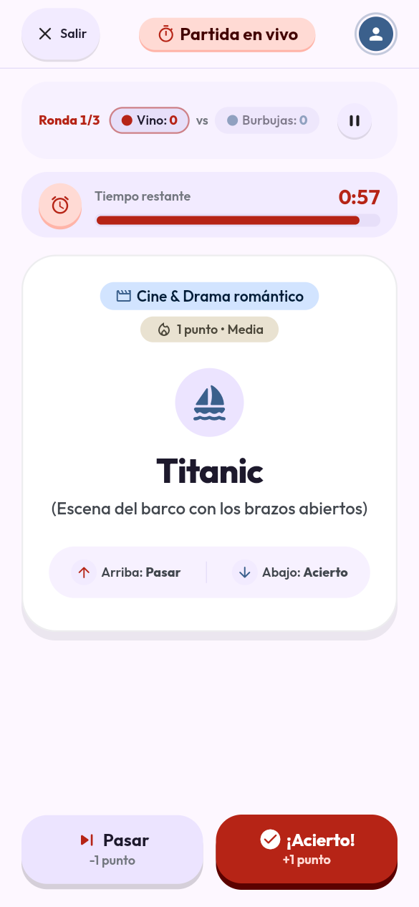 | 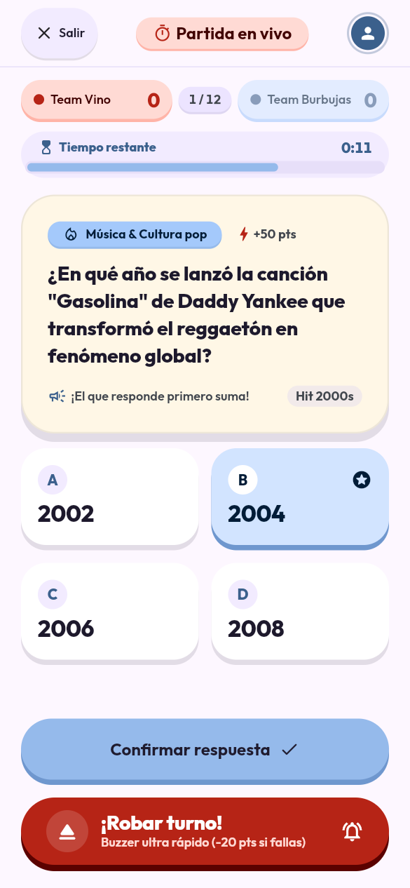 | 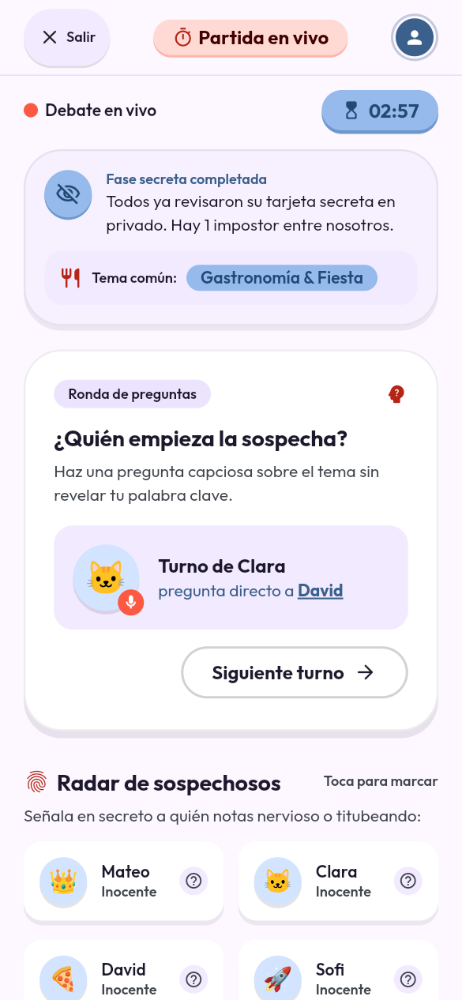 | 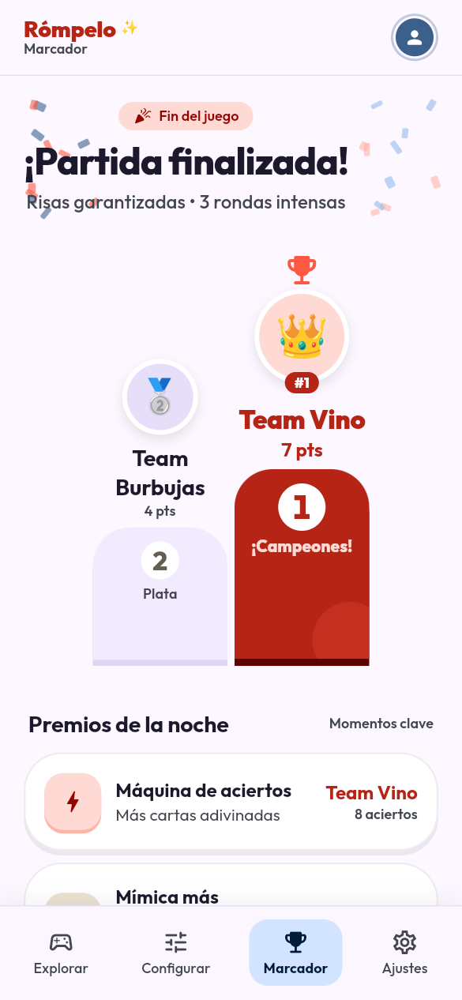 | 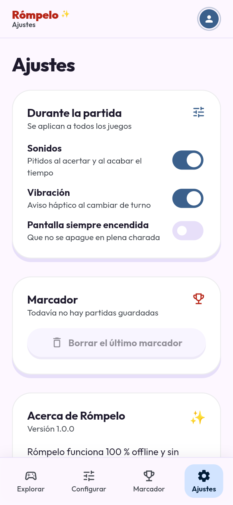 |

## Cómo ejecutar
Requisitos: [Flutter SDK](https://docs.flutter.dev/get-started/install) estable (probado con Flutter 3.47 /
Dart 3.13; el proyecto declara `sdk: '>=3.0.0 <4.0.0'`) y un emulador o dispositivo Android.
```bash
flutter pub get
flutter run          # en un emulador o dispositivo Android
flutter analyze      # análisis estático (debe dar "No issues found!")
flutter test         # todos los tests
dart format .        # formato estándar de Dart
```
Para verlo en el navegador sin emulador (solo para revisar la UI; el repo no incluye la plataforma web):
```bash
flutter create --platforms=web .            # temporal, no se commitea
flutter build web --no-web-resources-cdn    # sin el flag CanvasKit se pide a una CDN
cd build/web && python3 -m http.server 8765 # abrir http://localhost:8765/#/partida/trivia
```

## Stack y por qué
| Herramienta | Versión | Para qué | Por qué |
|---|---|---|---|
| Flutter / Dart | 3.47 / 3.13 | UI nativa | Una sola base de código compilada a nativo; widgets propios (no depende de los del sistema) para replicar el mockup "chunky" al píxel |
| `go_router` | ^17.5.0 | Navegación | Paquete oficial del equipo Flutter: rutas tipo URL (`/partida/trivia`), `StatefulShellRoute` para las 4 tabs con estado propio, redirecciones y fácil de testear (como Angular Router o React Router) |
| `flutter_riverpod` | ^3.4.3 | Estado | Providers tipados que no dependen del `BuildContext`, con `ref.watch` reactivo (como `useSelector`) y sobrescribibles en tests (como los providers del `TestBed` de Angular) |
| Fuente Outfit (TTF variable) | `assets/fonts/` | Tipografía | Empaquetada para cumplir el RNF offline (no se descarga en runtime) |
| `flutter_lints` | ^6.0.0 | Calidad | Reglas oficiales para `flutter analyze` |

## Estructura del código
Arquitectura **feature-first**: cada funcionalidad agrupa sus capas, en vez de una carpeta global de
"pantallas" y otra de "modelos".
```
lib/
  main.dart · app.dart            arranque (ProviderScope → MaterialApp.router)
  core/
    constants/                    colores (AppColors), espaciados y radios
    theme/app_theme.dart          ColorScheme + TextTheme Outfit, withWeight / tabular
    router/                       AppRoutes (constantes) y GoRouter con el shell de tabs
    utils/plural.dart             "1 ronda" / "3 rondas"
    widgets/                      sistema de diseño: ChunkyPressable (base táctil), ChunkyButton, ChunkyCard,
                                  PillChip, SelectionTile, SegmentedPills, CounterStepper, SectionHeader,
                                  RompeloAppBar, AppShellScaffold, LiveGameTopBar, TimerBar
  features/
    catalog/   domain/ (GameItem, GameVibe) · data/ (catálogo) · presentation/ (home) · widgets/
    setup/     domain/ (MatchSetup sealed) · data/ (mazos) · providers/ · presentation/ (3 configs + tab) · widgets/
    games/     domain/ (MatchResult) · data/ (contenido mock) · providers/ · widgets/ (LiveGameScaffold)
               charades/ · trivia/ · impostor/ · presentation/ (gamePlayScreenFor)
    results/   presentation/ (marcador) · widgets/ (Podium, AwardTile, StatTile, ConfettiBackdrop)
    settings/  providers/ (AppSettings) · presentation/
assets/fonts/   Outfit variable + licencia OFL
design/stitch/  mockup exportado (screen.png + code.html por pantalla) + DESIGN.md
docs/           plan maestro, fichas de fase, progreso y capturas
test/           tests unitarios, de widgets, de flujo y de accesibilidad
```

## Sistema de diseño
"Rómpelo Dynamic Party System" ([`DESIGN.md`](design/stitch/DESIGN.md)), mockup hecho en Google Stitch:
- **Colores** (`AppColors`): azul cielo `#95baeb` (ambiente), vino `#930400`/`#b62416` (acción y tensión),
  leche `#fff7e6` (superficies), tinta ciruela `#1f1b2e` (texto).
- **Tipografía** Outfit en tipo oración (nunca todo en mayúsculas). Es una fuente **variable**: el peso se
  aplica con `AppTheme.withWeight(style, peso)` (un `copyWith(fontWeight:)` solo no cambia el grosor) y las
  cifras de marcadores y timers con `AppTheme.tabular(style)` para que no "bailen".
- **Estilo "chunky"**: botones pill y tarjetas muy redondeadas con sombra sólida inferior que se hunde al
  presionar. Todo control táctil se construye sobre `ChunkyPressable`, que centraliza el gesto, el estado
  presionado, el área táctil mínima y la semántica.
- **Layout**: márgenes de 20 px, contenido limitado a 540 px en tablet y botones de acción en la zona del pulgar.

## Navegación y rutas
| Ruta | Pantalla | Barra inferior |
|---|---|---|
| `/` | Explorar (home) | ✅ |
| `/configurar` | Lista de juegos con su configuración | ✅ |
| `/configurar/:juego` | Configuración de `charadas`, `trivia` o `impostor` | ✅ (tab Configurar) |
| `/resultados` | Marcador (podio o estado vacío) | ✅ |
| `/ajustes` | Ajustes | ✅ |
| `/partida/:juego` | Partida a pantalla completa | ❌ |

- Las 4 tabs son un `StatefulShellRoute.indexedStack`: cada rama tiene su propio `Navigator` y conserva su
  estado al cambiar de tab.
- `/partida/:juego` cuelga del navigator raíz (`parentNavigatorKey`), por eso tapa la barra inferior.
  "Salir" y el "atrás" de Android (`PopScope`) piden confirmación.
- Un `:juego` que no existe en el catálogo redirige a `/`.
- Las rutas son constantes en `AppRoutes` (`AppRoutes.playGame('trivia')`), sin strings repetidos.
- El router es un provider (`appRouterProvider`): cada `ProviderScope` (app o test) tiene el suyo.

## Gestión de estado
Regla: **estado efímero en el widget, estado compartido en Riverpod**.

| Provider | Tipo | Qué guarda | Quién lo usa |
|---|---|---|---|
| `playerCountProvider` | `Notifier<int>` | Jugadores reunidos (selector mágico del home) | Home y valor inicial de cada configuración |
| `charadesSetupProvider`, `triviaSetupProvider`, `impostorSetupProvider` | `Notifier<…Setup>` | Configuración de cada juego (inmutable, `copyWith`) | Pantallas de configuración |
| `matchSetupProvider(gameId)` | `Provider.family` (solo lectura) | Configuración por id | Partidas y tab Configurar |
| `lastMatchResultProvider` | `Notifier<MatchResult?>` | Resultado de la última partida | Marcador y Ajustes |
| `appSettingsProvider` | `Notifier<AppSettings>` | Sonido, vibración, pantalla encendida (mock) | Ajustes |
| `liveTimersEnabledProvider` | `Provider<bool>` | Interruptor de timers (`false` en tests) | Partidas |
| `appRouterProvider` | `Provider<GoRouter>` | El router | `MaterialApp.router` |

- `MatchSetup` es una **`sealed class`** (`CharadesSetup`, `TriviaSetup`, `ImpostorSetup`): un `switch`
  sobre ella obliga a cubrir todos los juegos, como una unión discriminada de TypeScript.
- Los providers de configuración **no** son `autoDispose`: la configuración sobrevive y la revancha la reutiliza.
- La carta, el turno o la opción elegida de una partida viven en el `State` de la pantalla (`setState`);
  al terminar, solo el `MatchResult` (puntajes, premios, estadísticas) sube a `lastMatchResultProvider`.

## Cómo agregar un juego nuevo
1. **Catálogo:** una entrada en `features/catalog/data/games_catalog.dart` (id, textos, rango de jugadores,
   `GameAccent`, vibras). El id es también el segmento de la URL.
2. **Configuración:** una subclase de `MatchSetup` en `setup/domain/match_setup.dart`, su `Notifier` en
   `setup/providers/match_setup_provider.dart` (y un `case` en `matchSetupProvider`) y su pantalla en
   `setup/presentation/`. El compilador marcará el `switch` de `describeSetup` hasta que lo cubras.
3. **Mazos y contenido:** sus `DeckOption` en `setup/data/deck_options.dart` y el contenido con los mismos ids
   en `games/data/mock_game_content.dart`.
4. **Partida:** `games/<juego>/<juego>_play_screen.dart` sobre `LiveGameScaffold`; al terminar llama a
   `finishMatch(context, ref, MatchResult(...))` con sus puntajes y premios.
5. **Rutas:** un `case` en `gameConfigScreenFor` y otro en `gamePlayScreenFor` (las rutas `:juego` ya existen).
6. **Tests:** copia el patrón de `test/features/games/*_play_screen_test.dart`; el test de accesibilidad
   incluye las rutas nuevas agregándolas a su lista.

## Tests y calidad
```bash
flutter test                                   # 116 tests
flutter test test/full_flow_test.dart          # solo el flujo completo
flutter test test/accessibility_test.dart      # solo accesibilidad
```
| Tipo | Archivos | Qué cubre |
|---|---|---|
| Unitarios | `games_catalog_test`, `match_setup_test`, `*_provider_test`, `mock_game_content_test`, `results_screen_test` (modelo) | Reglas de dominio, providers, contenido mock, cálculos del resultado |
| Widgets | `test/core/widgets/`, `test/features/**/` | Cada pantalla y componente: interacción y estado |
| Flujo | `full_flow_test.dart`, `app_test.dart` | Home → configurar → partida → marcador → revancha → catálogo, solo con toques |
| Accesibilidad | `accessibility_test.dart` | 10 rutas × 3 guías (áreas táctiles, etiquetas, contraste) |

Notas para escribir tests:
- `test/test_utils.dart` → `pumpAppAt(tester, '/ruta', prepare: (container) {...})` monta la app real con los
  timers apagados. Un timer corriendo haría que `pumpAndSettle` esperara el turno entero.
- La fuente de test (Ahem) dibuja cada letra de 1 em: los tests usan viewports anchos (600–800 px) y el ancho
  móvil real se valida con capturas web.
- Las listas son perezosas: para tocar algo fuera de pantalla, `scrollUntilVisible` + `ensureVisible`.

## Accesibilidad
Verificada con las guías de `flutter_test` en todas las rutas (`test/accessibility_test.dart`):
- **Áreas táctiles ≥ 48 × 48 px** sin agrandar el dibujo: `ChunkyPressable` usa un `RenderBox` propio
  (`_MinTapArea`) que respeta las restricciones del padre y solo crece alrededor del control.
- **Etiquetas para TalkBack** en todos los controles, sin lecturas duplicadas (`excludeSemantics` cuando hay
  `semanticLabel`). Los botones de icono (pausa, campana, steppers) tienen etiqueta propia.
- **Contraste WCAG** de todos los textos.
- Ancho máximo de 540 px en tablet; tipografía grande y gruesa para leer a distancia.

## Changelog por fase
- **Fase 6 — Tests, pulido y README final:** test de flujo completo y test de accesibilidad (30 comprobaciones),
  área táctil mínima y semántica centralizadas en `ChunkyPressable`, campo de nombres de equipo a 48 px,
  podio centrado con 2 participantes, confeti fuera del texto, capturas en `docs/screenshots/`, este README.
- **Fase 5 — Resultados y tabs:** marcador con podio, tabla, premios y estadísticas calculados de la partida;
  revancha y vuelta al catálogo; tab Configurar con resumen de cada configuración; Ajustes mock; se eliminó
  `PlaceholderScreen`.
- **Fase 4 — Partidas:** Charadas, Trivia e Impostor a pantalla completa con contenido mock, `LiveGameTopBar`
  ("Salir" con confirmación) y `TimerBar` (`AnimationController`, pausable).
- **Fase 3 — Configuración:** `MatchSetup` sealed, un provider por juego, mazos, reglas y nombres de jugadores.
- **Fase 2 — Home:** selector mágico, juego al azar, filtro por vibra y tarjetas de juego.
- **Fase 1 — Fundaciones:** tema del mockup, fuente Outfit, router con 4 tabs y widgets core.
- **Fase 0 — Plan:** mockup de Stitch en el repo, plan maestro y fichas por fase.

Detalle de cada decisión en [`docs/progreso.md`](docs/progreso.md).

## Equipo
- Gabriel Sebastián Guevara Téllez
- Lesly Daniela Galindo Rivera
- Mateo Leal Rey

Docente: Andrés Felipe Vallejo Sastoque
